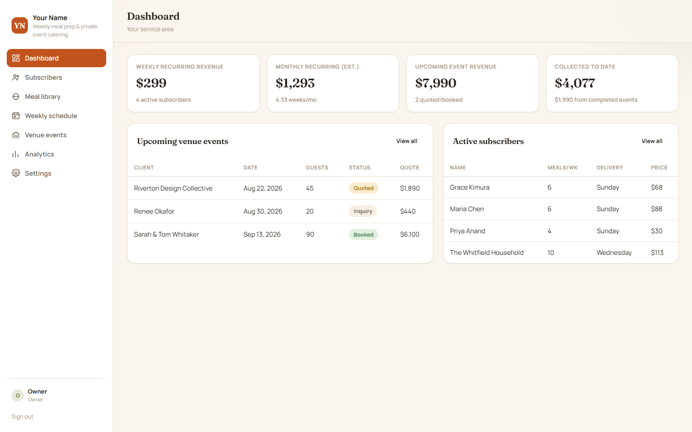
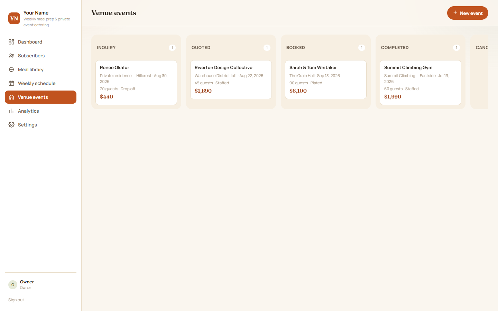
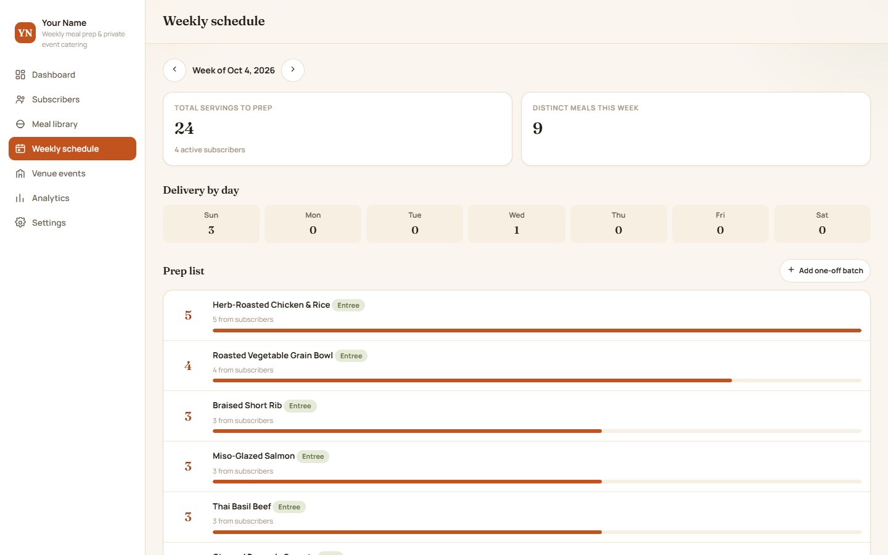
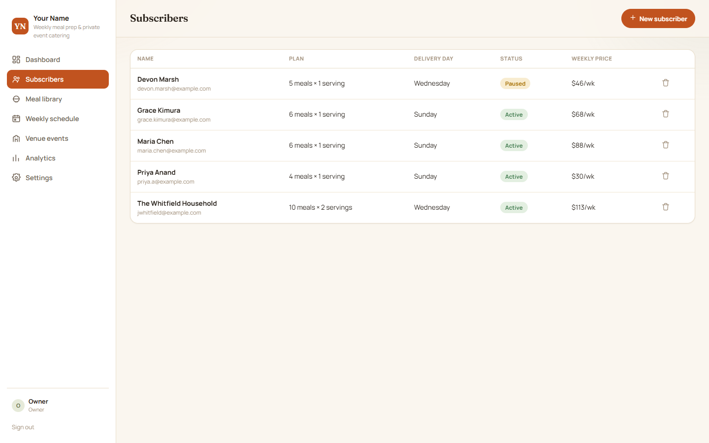
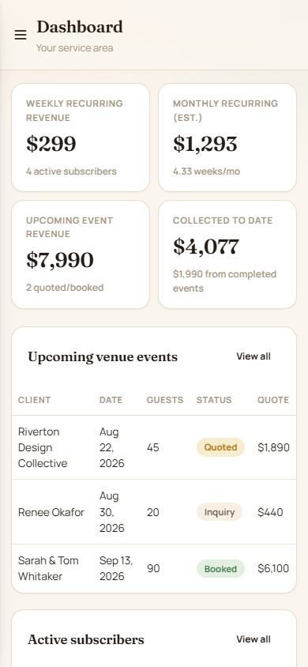
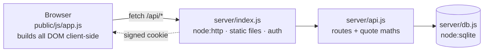

<h1 align="center">catering-crm</h1>

<p align="center">A CRM for independent chefs who run meal-prep subscriptions and private event catering side by side.</p>

<p align="center">
Zero npm dependencies. Node 22 and SQLite. Clone it and run it.
</p>



## What it does

| Area | What you get |
|---|---|
| **Subscribers** | Weekly customers with a standing meal order that prices itself from the menu and feeds the prep list. Active, paused or cancelled, with delivery day and dietary notes. |
| **Meal library** | The menu: price, unit, category and tags. Subscriptions and prep quantities both read from it. |
| **Weekly schedule** | Every active subscription rolled up into a prep list by meal and delivery day, plus one-off batches. Negative quantities handle skips. |
| **Venue events** | Inquiry, quoted, booked, completed board. Each event carries a quote: guests x per-person rate by service type, add-ons, travel, discount, tax and deposit. Totals are computed on the server, so the number on screen is the number billed. |
| **Analytics** | Recurring revenue, event revenue, collected to date, revenue by month and most-ordered meals. |
| **Settings** | Business name, brand colours, pricing, tax, deposit percentage, travel fees, service types and add-ons. Nothing needs a code change. |

<p>


</p>
<p>


</p>

## Who it is for

Independent chefs and small catering businesses that take recurring weekly orders and one-off events
and want one place to track both. It is a single-owner app: one owner account, no multi-tenant setup.

## Quick start

Requires Node 22 or newer. The server uses the built-in `node:sqlite` module.

```bash
node server/index.js     # http://localhost:3011
```

There is no `npm install` step. On first boot the app creates `data/chef.db` and seeds demo data:
5 subscribers, 11 meals, 4 events and 6 payments, so there is something to look at straight away.

Set `ADMIN_EMAIL` and `ADMIN_PASSWORD` before the first boot. If `ADMIN_PASSWORD` is not set, the seeded
owner account gets a random password that is printed once in the server log. Change it after the first login.
All settings are listed in [`.env.example`](.env.example).

### With Docker

```bash
docker build -t catering-crm .
docker run -p 3011:3011 -v catering-data:/app/data --env-file .env catering-crm
```

The image is built from `node:24-slim`. Mount a volume at `/app/data` so the SQLite file survives redeploys.

## Configuration

Copy `.env.example` to `.env` and set the values you need. Names only; never commit real values.

| Variable | Default | Purpose |
|---|---|---|
| `PORT` | `3011` | HTTP port the server listens on. |
| `SESSION_SECRET` | random at boot | Signs session cookies. Set it so logins survive a restart. |
| `ADMIN_EMAIL` | `owner@example.com` | Email of the owner account seeded on first boot. |
| `ADMIN_NAME` | `Owner` | Display name of the seeded owner account. |
| `ADMIN_PASSWORD` | random, logged once | Password of the seeded owner account. |
| `DB_PATH` | `./data/chef.db` | Location of the SQLite database file. |
| `DEMO_MODE` | `0` | Set to `1` to reset business data to the seed set on a timer. |
| `DEMO_RESET_MIN` | `20` | Minutes between demo resets when `DEMO_MODE=1`. |

## Demo mode

`DEMO_MODE=1` resets all business data to the seed set every `DEMO_RESET_MIN` minutes and on every boot,
and shows a banner saying so. User accounts are kept, so logins still work. The app also sends
`X-Robots-Tag: noindex, nofollow` in this mode. Useful for showing the app to someone without leaving
their changes behind.

## How it is built



- **No dependencies.** `node:http` and `node:sqlite`, nothing to install and nothing to break on a redeploy.
- **No server-side HTML templating.** The server sends static files and JSON, and the client renders everything.
- **Stateless sessions.** HMAC-signed cookies, so any process can verify any session.
- **Built for phones.** Safe-area insets, 16px inputs so iOS does not zoom, touch targets of about 44px and
  bottom-sheet modals. On touch devices you open a card and change its status, because iOS does not
  support HTML drag-and-drop.

## Project structure

```
catering-crm/
├── server/
│   ├── index.js     # HTTP server, static files, sessions, demo-mode timer
│   ├── api.js       # JSON API routes and quote calculations
│   └── db.js        # SQLite schema, seed data, demo reset
├── public/
│   ├── index.html   # App shell
│   ├── login.html   # Sign-in page
│   ├── css/style.css
│   └── js/app.js    # Client-side rendering and state
├── docs/screens/    # Screenshots used in this README
├── .env.example
├── Dockerfile
└── package.json
```

## Testing

There is no automated test suite in this repository. Verify changes by running the server with
`DEMO_MODE=1` and clicking through subscribers, the weekly schedule, venue events and settings.

## Contributing

Issues and pull requests are welcome. Keep the zero-dependency constraint: the project does not add
npm packages for runtime code.

## License

Released under the MIT License. See [LICENSE](LICENSE).
Built by [Dime Data](https://dimedata.cloud).
